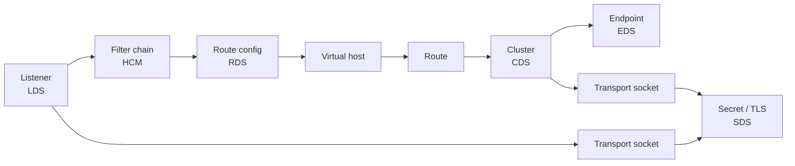

Everything Elchi pushes to Envoy is modeled as a **resource**. The UI generates a typed form for every resource directly from Envoy's protobuf definitions, so new Envoy fields appear in the editor without any manual UI work.

## Resource types

| Resource | xDS | Description |
| --- | --- | --- |
| Listeners | LDS | Entry points. Bind addresses, filter chains, TLS termination, and the HTTP/TCP filter pipeline. |
| Clusters | CDS | Upstream pools. Load-balancing policy, health checks, circuit breakers, transport sockets. |
| Routes | RDS | Route configurations and virtual hosts. Match rules, rewrites, retries, timeouts. |
| Endpoints | EDS | Concrete upstream addresses. Managed manually or synced live by Endpoint Discovery. |
| Secrets & TLS | SDS | Certificates, keys, and validation contexts. Issued automatically through ACME or uploaded. |
| Bootstrap | Boot | The static config each Envoy starts with — node ID, admin, and the xDS connection back to Elchi. |

At a glance — how the resources reference each other, from the listener down to endpoints and secrets:

## Filters & Extensions

HTTP, network, listener, and UDP filters are managed under **Filters**, and reusable custom configurations live under **Extensions**. Both are versioned per Envoy release and validated against the matching proto schema.

## Two-step validation

Every change is checked twice before it can ship:

1. **In the editor** — types generated from the Envoy API catch shape and type errors as you edit.
2. **On the server** — the Envoy API's validation rules run on the controller before the resource is persisted.

## Save & Publish

Edits are kept as drafts so you can stage several changes safely, then publish them together. The controller validates the bundle, persists it to MongoDB, and pushes a new snapshot to the control-plane — Envoy applies it without a restart.

:::info[Inspect what Envoy actually received]
The [Snapshot Dump](/envoy-configuration/snapshot-dump) shows the exact xDS payload streamed to a connected proxy — the fastest way to confirm a publish landed. To open it, open **Registry → Control Planes**, expand the control plane serving the listener and click **Details** in the node's **Snapshot** column (Registry is Admin/Owner only).
:::

## Understanding relationships

- **Dependency graph** — a Cytoscape view of how a resource links to clusters, routes, secrets, and filters. Use it to spot orphaned or broken references.
- **Route map** — a topology view of how requests flow through a listener's routes to upstreams.
- **Global search** — find any hostname, resource, or value across the project from one search box.
- **Templates & Snippets** — save reusable resource templates and config snippets to standardize new setups.
